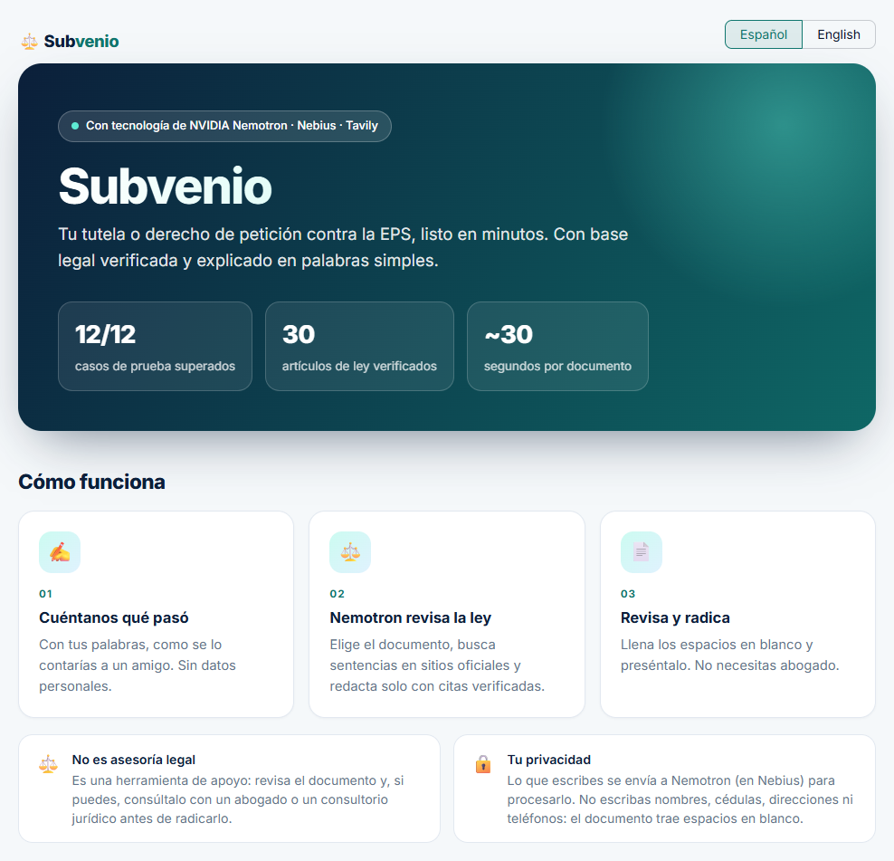
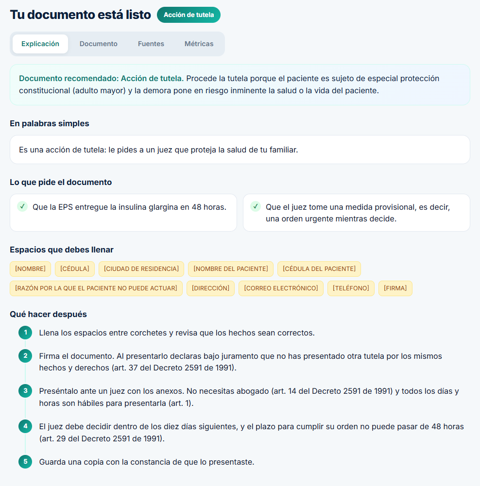
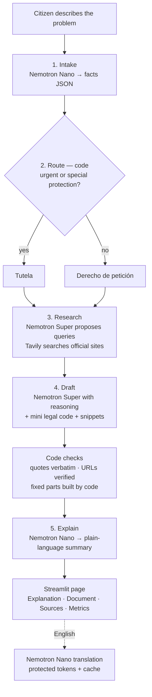

# Subvenio

_Subvenio_ is Latin for "I come to help".

**Turns a Colombian citizen's problem with their health insurer (EPS) into a ready-to-file
_tutela_ or _derecho de petición_, with verified legal grounds explained in plain words.**
Built with NVIDIA Nemotron on Nebius Token Factory, plus Tavily web search.

- **Live demo:** https://subvenio.streamlit.app/ (click one of the three example cases, then switch to English)
- **Video (< 3 min):** _coming soon_
- **Devpost:** https://nebiusglobalaihackathon.devpost.com
- **Track:** Best Apps and Agents

---

## The problem

In Colombia, health care is delivered through insurers called **EPS**. When an EPS denies a
prescribed medicine, never schedules an appointment or delays an authorization, the law gives
every citizen two free tools:

- **Derecho de petición** (formal petition): the EPS must answer in writing within 15 days.
- **Acción de tutela** (constitutional protection action): a judge must decide within 10 days
  when a fundamental right such as health or life is at risk. No lawyer is needed.

Health is one of the most common reasons Colombians file tutelas, yet the people who need them
most (older adults, parents of sick children, rural patients) often do not know which document
fits their case, which laws to cite, or how to write it. Lawyers are expensive, and generic
chatbots invent laws and court rulings, which is dangerous in a legal document.

## The solution

The citizen describes what happened in their own words. The app:

1. Extracts the facts of the case (who is affected, how urgent it is, whether the patient is a
   subject of special constitutional protection, whether someone writes on their behalf).
2. Chooses the right document with a fixed legal rule.
3. Searches official government sites for Constitutional Court rulings.
4. Writes the document, citing **only** verified laws and quotes that appear word for word in
   an official source.
5. Explains it in plain Spanish: what it asks for, which blanks to fill in, and what to do next
   (with the legal deadlines).

The page has four tabs: **Explanation**, **Document** (download as Markdown), **Sources** (every
search snippet, so the citizen can check each quote) and **Metrics** (model, tokens and time of
each step). A language switch shows everything in English for non-Spanish readers; the document
to file always stays in Spanish.

While the case runs, a progress panel shows each step and the Nemotron model doing it.





_The second screenshot shows the explanation tab with the app's built-in example answers
(demo mode, no AI calls)._

## Accuracy first: what the code guarantees

A legal document cannot contain invented laws, so the rule of this project is **"the model
reasons; the code handles everything that must be exact"**:

| Risk | What the code does |
|---|---|
| Invented laws or articles | The model may only cite a **mini legal code of 30 articles** (`data/legal/mini_codigo.json`): verbatim excerpts of the Constitution, Decreto 2591 de 1991, Ley 1755 de 2015 and Ley 1751 de 2015, checked against Función Pública's official pages by `scripts/verify_legal_corpus.py`. |
| Invented court quotes | Every «quote» must appear word for word in a Tavily snippet or in the legal code. Otherwise the whole citation is removed. |
| Invented URLs | Any URL that did not come from the search or the legal code is replaced. |
| Wrong parties, oath or annexes | Title, parties (including *agencia oficiosa*, when someone files for a patient who cannot), annexes, oath, notifications and signature are built by code, with blanks like `[NOMBRE]`. The model writes only the facts, rights, requests and legal grounds. |
| Wrong deadlines | "What to do next" is hand-written from the legal code, never generated. |
| Wrong document type | Tutela vs. petition is a fixed rule over the extracted facts (urgent risk or special protection), not a model guess. |
| Broken translation | Blanks, URLs, quotes and the title are replaced by tokens (`⟦1⟧`, `⟦2⟧`…) before translating and restored afterwards; if any token is lost, the Spanish version is shown. |

## How it uses NVIDIA Nemotron

Each step uses the smallest model that does the job well:

| Step | Model | Why |
|---|---|---|
| 1. Intake: extract the facts as JSON | **Nemotron 3 Nano** (`nvidia/NVIDIA-Nemotron-3-Nano-30B-A3B`), reasoning off | Fast, cheap structured extraction; turning reasoning off cut tokens ~5x with the same result. |
| 2. Route: tutela or petition | Code | A fixed legal rule; a model call flipped its answer between runs in our evaluation. |
| 3. Research: propose up to 3 search queries | **Nemotron 3 Super** (`nvidia/nemotron-3-super-120b-a12b`), reasoning off | Needs legal vocabulary to search well. Our code runs the searches. |
| 4. Draft: write the reasoning sections | **Nemotron 3 Super**, reasoning **on** | The hardest step: apply the right articles and rulings to the facts. |
| 5. Explain in plain language | **Nemotron 3 Nano**, reasoning off | Short summary for a citizen with no legal training. |
| Optional: translate to English | **Nemotron 3 Nano**, reasoning off | The explanation's case texts come back as validated JSON; the document is sent with protected tokens. Cached per case. |

Nemotron 3 Ultra was not needed: with the legal code in the prompt, Super's reasoning was
enough, and Super is faster and cheaper per case. JSON answers are validated with Pydantic and
retried once with the error message. Classification steps use temperature 0.

## How it uses Nebius Token Factory and Tavily

- **Nebius Token Factory** serves every model call at runtime through its OpenAI-compatible API
  (`https://api.tokenfactory.nebius.com/v1/`). All calls go through one module (`src/llm.py`)
  with timeouts, retries, and logging of model, tokens and latency (never the user's text).
- **Where it accelerated the work:** because the API is OpenAI-compatible, the standard `openai`
  Python client worked unchanged, and switching between Nano and Super is one string. Nemotron's
  reasoning switch is a single request field (`chat_template_kwargs.enable_thinking`), which let
  us measure each step with and without reasoning in minutes and keep it only where it pays off.
  One key gives access to both models, so routing tasks by size cost no extra setup.
- **Tavily** runs up to 3 searches per case at runtime, restricted to five official Colombian
  domains (Constitutional Court, Senate, Función Pública, Ministry of Health, Superintendency of
  Health). Its snippets are the only source the draft may quote rulings from.

## Architecture



Code map: `app.py` (interface) · `src/ui_text.py` (hand-written Spanish and English texts) ·
`src/ui_style.py` (styles and animations) · `src/agent.py` (pipeline and checks) · `src/document.py`
(fixed document parts) · `src/llm.py` (Nebius client) · `src/tools.py` (Tavily) ·
`src/prompts.py` · `src/legal.py` + `data/legal/mini_codigo.json` · `evals/` (evaluation set).

## Metrics and evaluation

An evaluation set of **12 invented cases** (6 tutelas, 6 petitions, including tricky ones such
as a non-urgent case written on behalf of a relative) is graded by plain code, not by another
model (`evals/checks.py`). Each case must choose the right document, detect who writes and
whether there is special protection, cite only laws from the legal code, contain no unverified
URL and no forbidden content (e.g. asking for court costs).

**Latest live run: 12/12 cases pass every rule. Average 12,672 tokens and 26 s of model time
per case.** 6/12 documents cite at least one Constitutional Court ruling; the rest rely only on
verified laws because quotes that were not exact were removed. Full table: [`evals/results.md`](evals/results.md).

The first run passed 10/12: the model changed its answer between runs in two cases. That led to
the code-based route and temperature 0 for classification steps.

Reproduce it (spends ~13k tokens per case; Tavily results are cached in `evals/tavily_cache.json`):

```bash
LLM_MODE=live python -m evals.run_eval                 # all cases
LLM_MODE=live python -m evals.run_eval 09_plantillas_ortopedicas   # one case
```

## Getting started

Requirements: Python 3.11+ (developed on 3.12), a Nebius Token Factory API key and a Tavily API
key (free plan is enough). Without keys the app runs in **mock mode** with canned answers.

```bash
git clone https://github.com/Santito268/NVIDIA-Global-AI-Hackathon-2026.git
cd NVIDIA-Global-AI-Hackathon-2026
python -m venv .venv
# Windows: .venv\Scripts\activate    macOS/Linux: source .venv/bin/activate
pip install -r requirements.txt
cp .env.example .env    # Windows: copy .env.example .env
```

Edit `.env`:

```
NEBIUS_API_KEY=your-nebius-key
NEBIUS_BASE_URL=https://api.tokenfactory.nebius.com/v1/
TAVILY_API_KEY=your-tavily-key
LLM_MODE=live
```

Run the app, the command-line version, or the tests (tests always use mock mode: no network,
no credits):

```bash
streamlit run app.py
python -m src.agent data/samples/caso_01.txt
python -m pytest
```

To deploy on Streamlit Community Cloud, add the same four values as TOML secrets
(`LLM_MODE = "live"`) and reboot the app after changing them.

## Limitations and next steps

- **Not legal advice.** It is a support tool; the citizen must review the document, and ideally
  check it with a lawyer or a free university legal clinic (*consultorio jurídico*).
- **Ruling quotes are verified as text, not as holdings.** A quote is copied word for word from
  a search snippet, but the snippet may come from the facts of that case or a lower-court stage
  rather than the Court's decision. The Sources tab shows every snippet so it can be checked.
- **Half of the documents cite no ruling.** Search snippets sometimes lose accents, so the model
  cannot copy them exactly and the quote filter removes them. Next: a small verified set of key
  health rulings, like the legal code.
- **The document type depends on two facts extracted by Nano** (urgent risk, special
  protection). The evaluation set is small (12 cases); more cases are needed.
- **Privacy:** the citizen's text is sent to Nebius. The page asks not to type names, ID numbers
  or addresses, and the document uses blanks for them, but the code does not scrub personal data.
- **Demo limits:** 3 cases per session and 50 per day for the whole app, to protect credits.
  Reloading resets the session limit; restarting the server resets the daily one.
- **English is a reference translation** by Nano; Spanish legal terms are not always kept.
- **Scope:** health insurers (EPS) only, two document types, and a 30-article legal code.
  Next: more legal areas (pensions, labor), a PDF/Word download, and a filing guide per city.

## License

[MIT](LICENSE)
